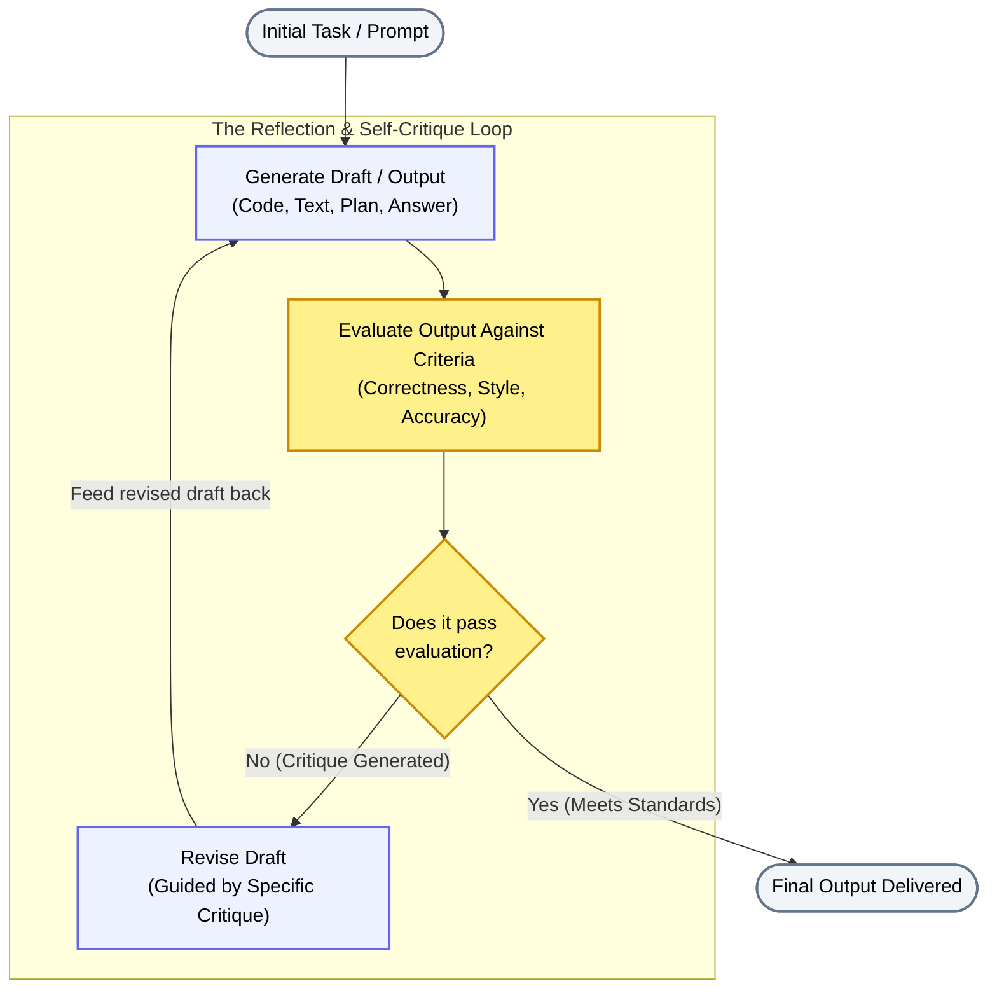

# Chapter 7: Reflection and Self-Critique

A developer writes a function, runs it, stares at the output, mutters "that's not right," and rewrites it. A writer finishes a paragraph, reads it back, crosses out half the words, and tightens the rest. This cycle — produce, evaluate, revise — is so fundamental to knowledge work that we barely notice we're doing it. It's also one of the most powerful patterns you can give an agent.

Reflection lets an LLM evaluate its own output and iteratively improve it. Instead of accepting whatever the model generates on the first pass, you add a loop: generate a draft, critique it against specific criteria, revise based on the critique, and repeat until the output meets your standards or you run out of iterations.

The results are striking. Research consistently shows that even one round of self-critique and revision produces meaningful improvements — 5-20% on specific benchmarks including math reasoning, code optimization, dialogue response generation, and sentiment transfer (Madaan et al., 2023). The first revision captures the biggest gains. Subsequent iterations show diminishing returns, but that first pass of self-editing is almost always worth the cost.

> [!NOTE]
> Self-Refine's gains are task-dependent. The strongest improvements appear on tasks where the model can meaningfully critique its own output (e.g., code with test cases, structured writing). For tasks where the base model is already near-optimal or where the model lacks the knowledge to self-diagnose errors, the improvement may be marginal. Always measure on your specific task before committing to the extra latency and cost.

## How It Works

The reflection pattern is a simple loop with three stages:



The **generate** step produces output — code, text, a plan, an answer. The **evaluate** step assesses that output against criteria — correctness, completeness, style, factual accuracy. If evaluation passes, the loop exits. If not, the **revise** step produces an improved version using the specific critique as guidance, and the loop repeats.

The evaluation step is where the design matters. A vague evaluation ("Is this good?") produces vague critique ("It could be improved") which produces minor, superficial revisions. A specific evaluation ("Does this code handle empty input? Does it return the correct type? Are edge cases covered?") produces actionable critique that drives real improvement.

## The Self-Refine Pattern

The simplest form of reflection: the same LLM generates, evaluates, and revises its own output.

```python
from openai import OpenAI

client = OpenAI()


def call_llm(prompt: str, system: str = "") -> str:
    messages = []
    if system:
        messages.append({"role": "system", "content": system})
    messages.append({"role": "user", "content": prompt})
    response = client.chat.completions.create(
        model="gpt-4o", messages=messages, temperature=0.7
    )
    return response.choices[0].message.content


def self_refine(task: str, max_iterations: int = 3) -> str:
    """Generate output with iterative self-refinement."""
    
    # Step 1: Initial generation
    draft = call_llm(task)
    
    for i in range(max_iterations):
        # Step 2: Self-critique
        critique = call_llm(
            f"Review this output and identify specific, actionable weaknesses. "
            f"Be concrete — point to exact phrases, missing elements, or "
            f"logical gaps. If the output is good enough, respond with "
            f"exactly 'PASS'.\n\n"
            f"TASK: {task}\n\n"
            f"OUTPUT:\n{draft}"
        )
        
        # Check if the model thinks it's good enough
        if "PASS" in critique.upper() and len(critique.strip()) < 20:
            break
        
        # Step 3: Revise based on critique
        draft = call_llm(
            f"Revise this output to address the following critique. "
            f"Make specific improvements — don't just rephrase.\n\n"
            f"ORIGINAL TASK: {task}\n\n"
            f"CURRENT DRAFT:\n{draft}\n\n"
            f"CRITIQUE:\n{critique}\n\n"
            f"REVISED OUTPUT:"
        )
    
    return draft
```

A subtle bug in the code above: it always returns the *latest* draft, even if an intermediate version was better. When regression happens (iteration 2 is worse than iteration 1), you lose the better version. Here's the fix:

```python
def self_refine_with_rollback(
    task: str,
    max_iterations: int = 3,
    score_fn=None,
) -> str:
    """Self-refinement with best-version tracking."""
    
    draft = call_llm(task)
    best_draft = draft
    best_score = score_fn(draft) if score_fn else 0
    
    for i in range(max_iterations):
        critique = call_llm(
            f"Review this output and identify specific, actionable weaknesses. "
            f"If the output is good enough, respond with exactly 'PASS'.\n\n"
            f"TASK: {task}\n\nOUTPUT:\n{draft}"
        )
        
        if "PASS" in critique.upper() and len(critique.strip()) < 20:
            break
        
        draft = call_llm(
            f"Revise this output to address the following critique.\n\n"
            f"ORIGINAL TASK: {task}\n\nCURRENT DRAFT:\n{draft}\n\n"
            f"CRITIQUE:\n{critique}\n\nREVISED OUTPUT:"
        )
        
        # Track the best version seen
        if score_fn:
            score = score_fn(draft)
            if score > best_score:
                best_draft = draft
                best_score = score
        else:
            best_draft = draft  # Without scoring, trust the latest
    
    return best_draft
```

The `score_fn` parameter accepts any callable that returns a numeric score — from a simple heuristic (word count, keyword presence) to an LLM-as-judge evaluation. When a revision regresses, the function returns the best version it saw, not the last one.

The critical detail is in the critique prompt: "identify **specific, actionable** weaknesses" and "point to **exact phrases**, missing elements, or logical gaps." Without this specificity, the model tends toward sycophantic feedback — "This is generally good but could be slightly improved in some areas" — which drives no real improvement.

The Self-Refine paper (Madaan et al., 2023) demonstrated this pattern across math reasoning, code generation, dialogue, and text generation, showing consistent improvement over single-pass generation. The pattern worked even though the same model served as both generator and critic — the change in prompting (from "write" to "critique") was enough to activate a different reasoning mode.

## The Reflexion Pattern

Self-Refine critiques the current draft. Reflexion (Shinn et al., 2023) goes further: it maintains a **memory of past attempts** so the agent doesn't repeat the same mistakes.

```python
def reflexion_loop(task: str, max_attempts: int = 3) -> str:
    """Generate with persistent learning across attempts."""
    reflections = []  # Memory of what went wrong
    
    for attempt in range(max_attempts):
        # Build context from past reflections
        reflection_context = ""
        if reflections:
            reflection_context = (
                "LESSONS FROM PREVIOUS ATTEMPTS:\n"
                + "\n".join(f"- {r}" for r in reflections)
                + "\n\nApply these lessons. Do NOT repeat previous mistakes.\n\n"
            )
        
        # Generate with awareness of past failures
        output = call_llm(
            f"{reflection_context}"
            f"TASK: {task}\n\n"
            f"Attempt {attempt + 1} of {max_attempts}."
        )
        
        # Evaluate — in practice, this might run tests, check facts, etc.
        evaluation = call_llm(
            f"Evaluate this output rigorously. Identify any errors, "
            f"omissions, or weaknesses.\n\n"
            f"TASK: {task}\n\nOUTPUT:\n{output}\n\n"
            f"If the output is correct and complete, respond 'PASS'. "
            f"Otherwise, explain what's wrong."
        )
        
        if "PASS" in evaluation.upper() and len(evaluation.strip()) < 20:
            return output
        
        # Reflect: what should I learn from this failure?
        reflection = call_llm(
            f"Based on this failed attempt, write a concise lesson "
            f"(one sentence) about what went wrong and what to do "
            f"differently next time.\n\n"
            f"TASK: {task}\n\nOUTPUT:\n{output}\n\n"
            f"EVALUATION:\n{evaluation}"
        )
        reflections.append(reflection)
    
    return output  # Return best attempt
```

The difference is subtle but powerful. Self-Refine says "here's your draft, here's what's wrong, fix it." Reflexion says "here's what went wrong in your past attempts — don't make those mistakes again." This persistent memory prevents the common failure mode where an agent fixes one problem but reintroduces a previously solved one.

Reflexion was originally demonstrated in code generation (HumanEval) and decision-making (ALFWorld), where it improved pass rates significantly across attempts. The verbal reflection memory proved more effective than simply concatenating previous attempts into context.

## Tool-Interactive Critiquing (CRITIC)

Self-Refine and Reflexion rely on the LLM's own judgment to evaluate output. But LLMs are unreliable evaluators of their own work — they sometimes approve incorrect code, validate false claims, and miss logical errors. The CRITIC pattern (Gou et al., 2024) strengthens evaluation by using **external tools** to verify output.

```python
import subprocess
import tempfile
import os


def evaluate_with_tests(code: str, tests: str) -> dict:
    """Run code against test cases and return results."""
    # Write code and tests to temp files
    with tempfile.TemporaryDirectory() as tmpdir:
        code_path = os.path.join(tmpdir, "solution.py")
        test_path = os.path.join(tmpdir, "test_solution.py")
        
        with open(code_path, "w") as f:
            f.write(code)
        with open(test_path, "w") as f:
            f.write(f"from solution import *\n{tests}")
        
        # Run tests in sandboxed environment
        # ⚠️ For production use, see Chapter 6 (Tool Use) for proper sandboxing
        # practices and Chapter 14 (Guardrails) for securing agent-generated code.
        result = subprocess.run(
            ["python", "-m", "pytest", test_path, "-v", "--tb=short"],
            capture_output=True,
            text=True,
            timeout=30,
            cwd=tmpdir,
        )
        
        return {
            "passed": result.returncode == 0,
            "output": result.stdout + result.stderr,
        }


def code_with_critic(task: str, tests: str, max_iterations: int = 3) -> str:
    """Generate code with test-based verification."""
    
    code = call_llm(
        f"Write Python code to solve this task. Return ONLY the code, "
        f"no explanations.\n\n{task}"
    )
    
    for i in range(max_iterations):
        # External verification, not LLM self-judgment
        result = evaluate_with_tests(code, tests)
        
        if result["passed"]:
            return code
        
        # Revise with concrete test feedback
        code = call_llm(
            f"This code failed tests. Fix it based on the error output.\n\n"
            f"TASK: {task}\n\n"
            f"CURRENT CODE:\n```python\n{code}\n```\n\n"
            f"TEST RESULTS:\n{result['output']}\n\n"
            f"Return ONLY the corrected code."
        )
    
    return code
```

The key shift: the evaluation step is **grounded in external reality**, not the LLM's opinion. Test results don't lie. A calculation either matches the expected answer or it doesn't. A web search either confirms a claim or contradicts it. This makes the critique reliable in ways that self-evaluation cannot be.

The CRITIC approach extends beyond tests:

- **Calculator as critic:** Generate a mathematical derivation → verify key steps with computation
- **Search as critic:** Generate a factual claim → verify against web search results
- **Type checker as critic:** Generate code → run a type checker → fix type errors
- **Linter as critic:** Generate code → run a linter → fix style and correctness issues

The general principle: **if you can verify it with a tool, don't rely on the LLM to verify it with self-reflection.** Use tools for verification and reserve LLM self-critique for subjective qualities (tone, clarity, creativity) where automated verification isn't possible.

## Two-Agent Reflection

Self-reflection has a well-documented weakness: models are reluctant to harshly criticize their own output. This is the sycophancy problem. One solution is to separate the generator and the critic into two distinct agents with different instructions — or even different models.

```python
def two_agent_reflection(
    task: str,
    max_iterations: int = 3,
    generator_model: str = "gpt-4o",
    critic_model: str = "gpt-4o",
) -> str:
    """Reflection with separate generator and critic agents."""
    
    generator_system = (
        "You are an expert writer. Produce the highest quality output you can. "
        "When revising, carefully address every point in the critique."
    )
    
    critic_system = (
        "You are a demanding editor. Your job is to find weaknesses. "
        "Be specific and concrete. Don't praise — only identify problems. "
        "If the output truly has no significant issues, respond with 'PASS'."
    )
    
    # Generate initial draft
    draft = call_llm(task, system=generator_system)
    
    for i in range(max_iterations):
        # Critique with a separate, adversarial prompt
        critique_messages = [
            {"role": "system", "content": critic_system},
            {"role": "user", "content": f"TASK: {task}\n\nOUTPUT:\n{draft}"}
        ]
        response = client.chat.completions.create(
            model=critic_model, messages=critique_messages
        )
        critique = response.choices[0].message.content
        
        if "PASS" in critique.upper() and len(critique.strip()) < 20:
            break
        
        # Revise based on external critique
        draft = call_llm(
            f"Revise your output based on this editorial feedback:\n\n"
            f"CRITIQUE:\n{critique}\n\n"
            f"ORIGINAL TASK: {task}\n\n"
            f"YOUR CURRENT DRAFT:\n{draft}\n\n"
            f"Produce an improved version.",
            system=generator_system,
        )
    
    return draft
```

The critic's system prompt is deliberately adversarial: "Don't praise — only identify problems." This counteracts the sycophancy tendency. You can even use a cheaper, faster model as the critic (gpt-4o-mini) — the quality of critique doesn't always require the most capable model, especially when the criteria are well-defined.

## Case Study: Code Generation with Test Feedback

A software team uses an agent to generate implementation code from specifications. Without reflection, the agent generates code that passes 62% of test cases on the first attempt. Here's how reflection transforms the results.

**Setup:**
- Task: Generate Python functions from docstring specifications
- Evaluation: Run generated code against a hidden test suite (10-15 tests per function)
- Models: gpt-4o for generation, pytest for verification

**Without reflection (single pass):**
- Average test pass rate: 62%
- Common failures: edge cases (empty input, boundary values), off-by-one errors, type handling

**With Self-Refine (LLM self-critique):**
- Iteration 1: 62% → 73% (model catches obvious logical errors)
- Iteration 2: 73% → 76% (diminishing returns — model misses deeper issues)
- Iteration 3: 76% → 77% (barely measurable improvement)

**With CRITIC (test-based feedback):**
- Iteration 1: 62% → 81% (concrete test failures guide precise fixes)
- Iteration 2: 81% → 88% (remaining failures are edge cases the model now addresses)
- Iteration 3: 88% → 91% (final edge cases resolved)

The difference is clear. Self-Refine improves output through the LLM's general reasoning — it catches things that don't "look right." CRITIC improves output through concrete evidence — exact test failures with exact error messages. The LLM doesn't need to guess what's wrong when pytest tells it `AssertionError: expected [1, 2, 3] but got [2, 3]`.

**Key finding:** Iteration 1 of CRITIC produces better results than iteration 3 of Self-Refine. Grounded feedback is worth more than multiple rounds of self-reflection.

## Framework Spotlight: LangGraph Cycles

LangGraph makes reflection natural because its graph-based execution model supports cycles — edges that loop back to earlier nodes.

```python
from langgraph.graph import StateGraph, END
from typing import TypedDict


class ReflectionState(TypedDict):
    task: str
    draft: str
    critique: str
    iteration: int
    max_iterations: int


def generate(state: ReflectionState) -> dict:
    """Generate or revise the draft."""
    if state.get("critique"):
        # Revision mode
        draft = call_llm(
            f"Revise based on critique:\n{state['critique']}\n\n"
            f"Current draft:\n{state['draft']}"
        )
    else:
        # Initial generation
        draft = call_llm(state["task"])
    
    return {"draft": draft, "iteration": state.get("iteration", 0) + 1}


def evaluate(state: ReflectionState) -> dict:
    """Critique the current draft."""
    critique = call_llm(
        f"Find specific weaknesses in this output.\n\n"
        f"Task: {state['task']}\nOutput: {state['draft']}\n\n"
        f"If it's good enough, respond 'PASS'."
    )
    return {"critique": critique}


def should_continue(state: ReflectionState) -> str:
    """Decide whether to revise or finish."""
    if state["iteration"] >= state["max_iterations"]:
        return "end"
    if "PASS" in state.get("critique", "").upper():
        return "end"
    return "revise"


# Build the graph
graph = StateGraph(ReflectionState)
graph.add_node("generate", generate)
graph.add_node("evaluate", evaluate)

graph.set_entry_point("generate")
graph.add_edge("generate", "evaluate")
graph.add_conditional_edges(
    "evaluate",
    should_continue,
    {"revise": "generate", "end": END},
)

reflection_agent = graph.compile()

# Run it
result = reflection_agent.invoke({
    "task": "Write a function to merge two sorted arrays",
    "draft": "",
    "critique": "",
    "iteration": 0,
    "max_iterations": 3,
})
```

LangGraph's `add_conditional_edges` creates the loop naturally: after evaluation, the graph either cycles back to generation or exits. The state carries the critique between iterations, and the iteration counter prevents infinite loops. This is cleaner than managing a while loop manually, especially when reflection is one component of a larger agent workflow.

## Token Cost Profile

> **Cost structure:** (2N + 1) LLM calls for N reflection iterations: 1 initial generation + N critique calls + N revision calls.
>
> **Typical range:** A 2-iteration reflection loop on a 500-word output generates roughly 15,000–25,000 total tokens across 5 LLM calls. Each iteration roughly doubles cumulative token spend because revisions carry forward the critique and prior output.
>
> **Cost multiplier vs. single call:** 3× (1 iteration) to 7× (3 iterations). Diminishing quality returns mean the first iteration is almost always worth the cost; the third rarely is.
>
> **Where cost grows:** Long outputs (each revision reprocesses the full text), verbose critiques, and high iteration counts. The evaluation step is often cheaper than the generation step — use a smaller model for critique when criteria are clear.
>
> **Cost-saving tip:** Tool-grounded reflection (running tests, checking formatting) shifts cost from LLM calls to deterministic computation — often cheaper and more reliable.

## Tradeoffs and Failure Modes

**Diminishing returns.** Most improvement happens in the first iteration. The gap between iteration 1 and iteration 2 is typically much smaller than iteration 0 to iteration 1. Three iterations is usually the practical maximum before you're paying more in tokens than you're gaining in quality.

**Regression.** Sometimes revision makes things worse. The model "fixes" something that wasn't broken, or addresses the critique in a way that introduces new problems. This is more common with vague critique and weak revision prompts. Mitigation: keep the best version seen so far, and compare each revision against it.

**Sycophantic self-critique.** Models evaluating their own output tend to be too generous. "This is quite good, with perhaps minor room for improvement in..." is not actionable critique. Mitigation: use adversarial critic prompts, separate critic agents, or tool-based verification.

**Cost multiplication.** Each reflection iteration multiplies your LLM calls. A 3-iteration loop means roughly 7 LLM calls (generate + critique + revise + critique + revise + critique + pass). With expensive models, this matters. Budget carefully and use cheap models for critique when the evaluation criteria are clear.

**Infinite loops.** A critic that never says "PASS" and a generator that never fully satisfies the critic. Always set `max_iterations`. Consider also detecting when the critique is repeating the same points — the model is stuck.

### Observability Checklist

> **What to log:** Each iteration's output, critique text, scores (if structured), iteration count at termination, termination reason (passed, max iterations, stagnation), total tokens consumed.
>
> **Key metrics:** Average iterations to convergence, quality score progression per iteration (should show diminishing gains), regression rate (how often iteration N scores lower than N-1), stagnation rate (how often looping stops due to plateau).
>
> **Alerts to set:** Average iteration count increasing over time (critique prompt may need tuning), regression rate exceeding 10% (revision prompt needs improvement), max_iterations hit rate exceeding 15% (quality target may be unrealistic).
>
> **Debugging tip:** Plot quality scores across iterations as a time series. A healthy reflection loop shows a curve that rises steeply then flattens. If scores oscillate (up, down, up, down), the critique and revision prompts are fighting each other.

## When NOT to Use

- **Tasks where first-pass output is consistently good enough.** If the model produces acceptable results 95% of the time, reflection adds cost without adding value. Measure first.

- **Cost-sensitive applications.** If your budget is tight, reflection triples your token spend (minimum). Use that budget for more calls, not deeper reflection on fewer calls.

- **Tasks without clear evaluation criteria.** Reflection needs a standard to judge against. "Write something creative" has no clear bar — the critic doesn't know when to stop. "Write a function that passes these tests" has a clear, binary bar. The clearer the criteria, the more effective reflection becomes.

- **Real-time interactions.** If users are waiting for a response, 3 rounds of generate-critique-revise adds unacceptable latency. Use reflection for background tasks and offline processing, not for chat.

## Review Questions

**Knowledge & Design Questions:**

1. The chapter states that self-critique gains are "task-dependent." For each of these tasks, predict whether reflection would provide significant improvement (5-20%+) or marginal improvement (<5%): (A) Generating SQL queries with test cases available, (B) Translating text between languages, (C) Summarizing a single news article, (D) Fixing a bug given error traces and logs. Justify each prediction based on the chapter's guidance.

2. The reflection loop has three stages: generate, evaluate, revise. The quality of improvement depends heavily on the *evaluation criteria*. Design evaluation criteria for: (A) code generation, (B) marketing copy, (C) technical documentation. For each, explain what vague criteria would miss and what specific criteria would catch.

3. Reflection adds cost and latency — you make at least 2 LLM calls instead of 1 (generate + evaluate, then revise if needed). For what types of tasks is this cost justified? When should you skip reflection and accept the first-draft output? How would you decide this trade-off for a new task?

4. The chapter mentions "the first revision captures the biggest gains." Design a stopping criterion for the revision loop: when should you stop iterating? Should you always do at least one revision? Should you cap the maximum number of revisions? Justify your choices based on cost vs. quality.

**Implementation Questions:**

5. Implement the self-refine pattern from the chapter with a concrete task — e.g., code generation or essay writing. Write working Python code that: (1) generates a first draft, (2) uses a specific rubric to critique it, (3) revises based on the critique, (4) repeats up to 3 times or until the output passes. Include a stopping condition that detects when further revision is unlikely to help.

6. Build a reflection system for an API documentation generator: given a function signature, generate documentation, then critique it for clarity, completeness, and correctness. Implement: (1) the generation step, (2) a multi-criteria evaluation (is it clear? Is it complete? Are examples correct?), (3) revision based on which criteria failed. Write working code and test it on 2-3 real function signatures.

## Sources

- Madaan, A., et al. "Self-Refine: Iterative Refinement with Self-Feedback." *NeurIPS 2023*. https://arxiv.org/abs/2303.17651
- Shinn, N., et al. "Reflexion: Language Agents with Verbal Reinforcement Learning." *NeurIPS 2023*. https://arxiv.org/abs/2303.11366
- Gou, Z., et al. "CRITIC: Large Language Models Can Self-Correct with Tool-Interactive Critiquing." *ICLR 2024*. https://arxiv.org/abs/2305.11738
- Anthropic. "Building Effective Agents." *Anthropic Engineering Blog*, December 2024. https://www.anthropic.com/engineering/building-effective-agents. Accessed April 2025.
